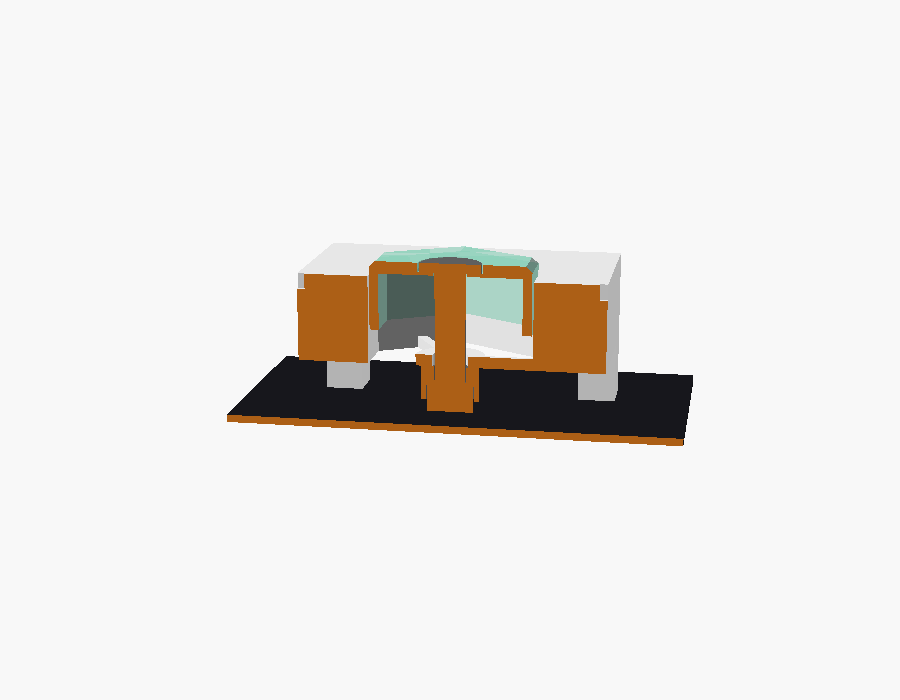

# hardware

OpenSCAD source and ready-to-print STLs for the overlay. All dimensions are hardcoded in `common.scad` (mm). z = 0 is the iPad glass.

## How a key works
A translucent hex cap slides in a hex bore. A spring between the cap's ceiling and a three-spoke spring seat (the "spider") holds it up. A conductive plunger runs through the cap: its head sits flush in the top of the cap where your finger lands, and its stem passes through the spider to a conductive cup holding a foam tip. The cup is wider than the spider's hole, so it also stops the key at the top.

| Position | Value |
|---|---|
| Foam to glass at rest | 2.0 mm |
| Travel to first touch | 2.0 mm |
| Extra travel (foam compresses, pressure range) | 1.0 mm |
| Cap top above glass at rest | 21.5 mm (2 mm above the frame) |
| Bore | 21.4 mm flat (cap 21.0 mm: 0.2 mm clearance per side) |
| Key pitch | 24.15 mm (matches `app/js/geometry.js`) |

## Files
| File | Part | Material | Qty | Print |
|---|---|---|---|---|
| `cap.scad` | key cap | translucent PETG | 51 (+1 test) | top face down, no supports |
| `plunger.scad` | plunger (head + stem) | conductive PLA | 51 (+1) | head down, no supports, 0.12–0.16 mm layers |
| `tip_cup.scad` | tip cup | conductive PLA | 51 (+1) | as modelled (pocket down), no supports |
| `test_key.scad` | 1-key test housing (step 1) | PLA | 1 | upside down (top face on bed), no supports |
| `cluster7.scad` | 7-key cluster housing (step 3) | PLA | 1 | upside down, no supports |
| `frame.scad` | full 51-key frame (step 6) | PLA or PETG | 1 | upside down, no supports; **needs a 256 mm bed** (252.6 × 183.5 mm) |
| `preview.scad` | cross-section check | — | — | not for printing |

STLs are in `stl/`, previews in `img/`.

## Bill of materials (full overlay)
- Translucent PETG: ~75 g (caps).
- Conductive PLA (e.g. Proto-pasta Conductive PLA): ~25 g (plungers + cups).
- PLA/PETG for the frame: 327 cm³ solid; roughly 130–180 g at 3 walls / 15 % infill.
- Compression springs: 52 × 0.5 mm wire, 7 mm OD, ~15 mm free length (from an assortment).
- Conductive (ESD) foam sheet, cut into 52 discs of 6 mm diameter × 3.5 mm thick (a 6 mm leather punch works). If your foam is thicker, change `FOAM_PROTRUDE` in `common.scad`.
- Optional: conductive glue or a dab of CA glue to hold foam in the cups.

## Assembly (per key)
1. Drop the plunger into the cap from the top; the head seats in the counterbore.
2. Slide a spring over the stem inside the cap.
3. Push the cap into its bore from the top so the stem passes through the spider.
4. From underneath, press the cap down a little and push the tip cup onto the stem (press fit; add glue if loose).
5. Press a foam disc into the cup's pocket.

## Fitting the frame
- The bezel band rests on the glass only outside the active screen area; the corner clips wrap the iPad's four corners.
- Control-strip window goes along the top edge of the screen in landscape. Lock the iPad's rotation so the app's strip stays under it.
- **Measure before printing the frame:** the iPad body (247.6 × 178.5 × 6.1 mm) is from Apple's spec, but the corner radius (`IPAD_R = 18`) and the assumption that the screen is centred in the body are estimates. Check the clips don't cover the top button; shorten `CLIP_Y` if they do.

## Test order
1. Print `test_key`, one cap, plunger, cup; assemble; place on the touch-test outline. Check registration, release and pressure.
2. Tune clearances (`BORE_FLAT`, `SOCKET_D`, spring choice) before printing more.
3. Print `cluster7` and check chords and neighbour crosstalk.
4. Print the frame.
